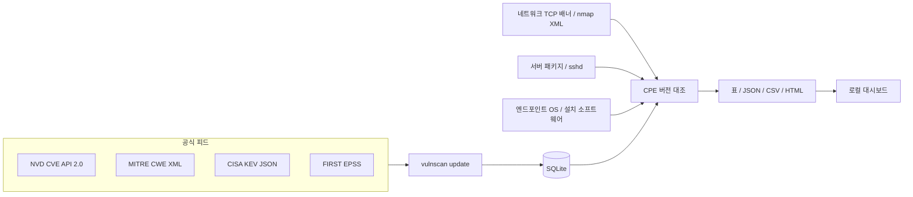
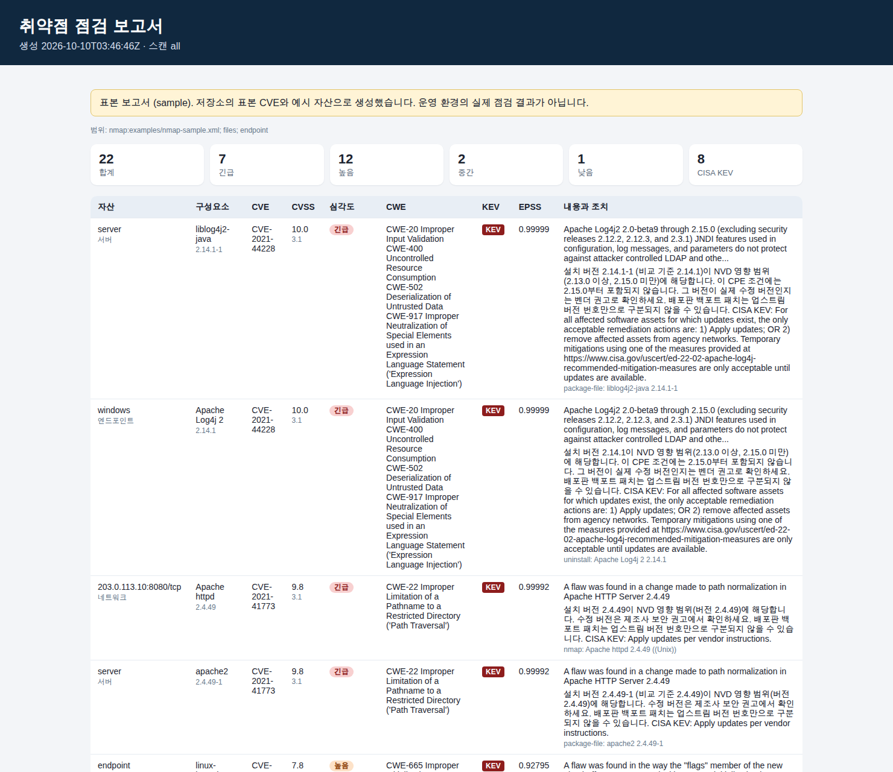
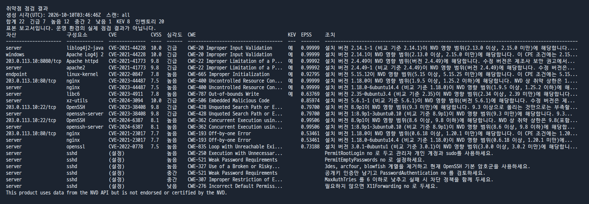

# vulnscan

인가된 네트워크, 서버, 엔드포인트만 대상으로 하는 CVE/CWE 기반 취약점 점검 도구입니다. 최규선(정보관리기술사)이 운영하는 IT 시스템을 방어적으로 점검하기 위해 만들었습니다. 익스플로잇, 무차별 대입, 인증 시도, 공격 페이로드 전송은 하지 않습니다.

This product uses data from the NVD API but is not endorsed or certified by the NVD.

## 개요

공개 취약점 정보를 로컬 SQLite에 모아 두고, 사용자가 명시한 자산의 제품·버전과 대조합니다. 수집은 공식 API와 다운로드 피드만 사용합니다. HTML 스크레이핑은 하지 않습니다.

점검 결과는 CVE, CVSS, 심각도, CWE 이름, CISA KEV 여부, FIRST EPSS, 영향 자산, 조치 힌트를 위험도가 높은 순으로 보여 줍니다. 터미널 표, JSON, CSV, 단일 파일 HTML로 출력합니다.

이 도구는 상용 스캐너를 대체하지 않습니다. CPE 대조는 오탐과 미탐이 있습니다. 결과는 제조사 권고와 함께 읽어야 합니다.

## 주요 기능

- **수집.** NVD CVE API 2.0을 `lastModified` 구간으로 증분 반영합니다. API 키는 환경 변수 `NVD_API_KEY`로만 넘깁니다. MITRE CWE XML, CISA KEV JSON, FIRST EPSS를 함께 넣을 수 있습니다.
- **저장.** CVE ID, 영문 설명, CVSS v3.x와 v4.0의 점수·벡터·심각도, CWE, CPE 구성, 공개·수정 시각, KEV, EPSS를 SQLite에 둡니다. `export`로 JSON/CSV를 뽑습니다. DB 파일은 저장소에 넣지 않습니다.
- **네트워크.** 사용자가 지정한 호스트나 CIDR에 TCP 연결만 하고, 배너와 HTTP `HEAD /` 응답으로 제품·버전을 추정합니다. nmap XML(`-oX`) 반입도 됩니다. `--i-am-authorized`가 없으면 실행하지 않습니다.
- **서버.** 로컬 리눅스의 dpkg/rpm과 pip 목록, `sshd_config`를 읽습니다. root 로그인, 비밀번호 인증, 빈 비밀번호, 약한 암호군 등을 CWE에 대응해 표시합니다.
- **엔드포인트.** 리눅스 `os-release`와 커널, macOS `sw_vers`/`system_profiler`, 윈도우 제거 레지스트리(Uninstall 키)를 목록으로 만들고 CVE와 대조합니다.
- **보고서.** 한국어 라벨의 터미널 표, JSON, CSV(엑셀용 UTF-8 BOM), HTML. 로컬 대시보드는 기본적으로 `127.0.0.1`만 엽니다.

## 구조도



디렉터리 구성은 다음과 같습니다.

```text
src/vulnscan/
  cli.py                 명령줄
  db.py                  SQLite 스키마
  collect/               NVD, CWE, KEV, EPSS
  match/                 버전 비교, CPE 2.3, 패키지-CPE 목록
  assess/                네트워크, 서버, 엔드포인트
  report/render.py       표, JSON, CSV, HTML
  dashboard.py           127.0.0.1 전용 조회
  data/sample/           테스트·시연용 작은 표본
examples/                재현 가능한 예시 입력
tests/                   네트워크를 열지 않는 pytest
docs/sample-report.html 표본 실행으로 만든 HTML
docs/images/             그 결과의 화면 캡처
```

## 설치

Python 3.11 이상이 필요합니다. 외부 런타임 라이브러리는 없습니다. 개발 도구만 pytest와 ruff입니다.

```bash
python -m pip install -e ".[dev]"
vulnscan --version
```

데이터베이스 기본 경로는 현재 디렉터리의 `vulnscan.db`입니다. `--db` 또는 환경 변수 `VULNSCAN_DB`로 바꿉니다. `*.db`는 `.gitignore`에 있습니다.

## 사용법

아래 예시는 이 저장소의 표본으로 2026-10-10에 실제로 실행한 명령입니다. 표본 배너가 붙은 결과는 운영 점검이 아닙니다.

### 표본 데이터로 오프라인 적재

NVD에 접속하지 않습니다. 저장소에 넣어 둔 CVE 10건, CWE 발췌, KEV 5건, EPSS 10건을 넣습니다.

```bash
vulnscan update --sample
```

실행 결과:

```text
CVE 10건, CWE 34건 저장 (vulnscan.db)
nvd: 10
cwe: 34
kev: 5
epss: 10
```

### 공식 피드 증분 반영

키가 없으면 요청 사이 6초, 키가 있으면 0.6초를 둡니다. NVD 날짜 창은 한 번에 119일을 넘기지 않도록 나눕니다. 커서가 없으면 최근 7일만 받습니다. 전체 이력을 받으려면 `--since`로 구간을 지정합니다.

```bash
export NVD_API_KEY="발급받은 키"   # 없어도 동작합니다. 없으면 공개 한도입니다.
vulnscan update --days 7
vulnscan update --since 2024-01-01 --until 2024-04-01
vulnscan update --cve-id CVE-2024-6387
vulnscan update --source epss --epss-feed
```

로컬에 CVE가 2,000건 이하이면 EPSS API로 그 CVE만 보강합니다. 그보다 많거나 `--epss-feed`이면 일일 CSV 피드를 받습니다.

이미 받아 둔 파일도 넣을 수 있습니다.

```bash
vulnscan update --source nvd --nvd-file path/to/nvd.json
vulnscan update --source cwe --cwe-file path/to/cwec.xml
vulnscan update --source kev --kev-file path/to/known_exploited_vulnerabilities.json
```

### 네트워크

대상은 쉼표로 구분합니다. CIDR은 기본 256대, 포트 조합은 기본 4,096회를 넘기면 거부합니다. `0.0.0.0/0`은 받지 않습니다.

```bash
vulnscan network \
  --targets 203.0.113.10 \
  --ports 22,80,443 \
  --i-am-authorized
```

`--i-am-authorized`가 없으면 종료 코드 2로 멈추고, 포트를 열지 않습니다. 이 플래그는 인가가 있다는 운영자 선언일 뿐이며, 도구는 권한을 확인하지 못합니다.

nmap 결과 반입도 같은 선언이 필요합니다. 아래는 문서용 대역 `203.0.113.10`을 담은 예시 XML입니다.

```bash
vulnscan network \
  --nmap-xml examples/nmap-sample.xml \
  --i-am-authorized \
  --sample
```

이 환경에서 `127.0.0.1`의 22, 80, 443포트를 인가 선언 후 연결했을 때는 열린 포트가 없어 발견 0건이었습니다. 자신의 호스트만 지정하십시오.

### 서버

파일만 주면 이 호스트의 패키지를 섞지 않습니다.

```bash
vulnscan server --no-local \
  --packages-file examples/packages-sample.txt \
  --pip-file examples/pip-sample.json \
  --sshd-config examples/sshd-sample.conf \
  --sample
```

옵션 없이 `vulnscan server`를 실행하면 로컬 dpkg 또는 rpm, `python -m pip list`, 읽을 수 있는 `/etc/ssh/sshd_config`를 사용합니다. `Include`로 나뉜 sshd 조각은 따라가지 않습니다.

### 엔드포인트

```bash
vulnscan endpoint --no-local \
  --os-release-file examples/os-release-sample \
  --kernel 5.15.12 \
  --uninstall-json examples/windows-uninstall-sample.json \
  --apps-json examples/macos-apps-sample.json \
  --sw-vers-file examples/sw-vers-sample.txt \
  --sample
```

리눅스에서 옵션 없이 실행하면 `os-release`, `uname -r`, 패키지 목록을 읽습니다. `5.15.0-119-generic`처럼 배포판 접미사가 있는 커널은 `linux:linux_kernel` CPE와 비교하지 않습니다. 백포트 때문에 오탐이 나기 때문입니다. 윈도우 레지스트리 읽기는 Windows에서만 동작합니다.

### 보고서

```bash
vulnscan report --scan-id all --sample
vulnscan report --scan-id all --format html --out report.html --sample
vulnscan report --scan-id all --format json --out report.json
vulnscan report --scan-id all --format csv --out report.csv
vulnscan export --kind cve --format json --out cves.json
```

표본 실행의 표준 출력 앞부분은 다음과 같습니다. 전문은 [docs/sample-cli-output.txt](docs/sample-cli-output.txt)에 있습니다.

```text
취약점 점검 결과
생성 시각(UTC): 2026-10-10T03:46:46Z  스캔: all
합계 22  긴급 7  높음 12  중간 2  낮음 1  KEV 8  인벤토리 20
표본 보고서입니다. 운영 환경의 실제 점검 결과가 아닙니다.
```

정렬은 KEV, CVSS, EPSS를 반영한 위험 점수 내림차순입니다. 조치 문장은 NVD CPE의 버전 상한에서 만들며, 그 값이 곧 벤더의 수정 버전이라고 단정하지 않습니다.

### 로컬 대시보드

인증이 없습니다. 기본 바인드는 `127.0.0.1`입니다.

```bash
vulnscan dashboard --host 127.0.0.1 --port 8765
```

`http://127.0.0.1:8765/?scan_id=all` 은 저장된 발견 사항 전체입니다. `/api/findings`는 JSON입니다. `0.0.0.0`에 열려면 `--allow-remote`가 필요하고, 그 경우에도 인증은 없습니다.

## 표본 보고서

아래 이미지는 위 표본 명령을 2026-10-10에 실행해 만든 결과입니다. 운영 환경의 실제 점검이 아닙니다. HTML 원본은 [docs/sample-report.html](docs/sample-report.html)입니다.





## 데이터 출처와 라이선스

이 저장소의 프로그램 코드는 MIT 라이선스입니다. 취약점 데이터는 각자 출처의 조건을 따릅니다. 표본 파일의 출처 메모는 [src/vulnscan/data/sample/SOURCES.txt](src/vulnscan/data/sample/SOURCES.txt)에 있습니다. 전체 DB는 커밋하지 않습니다.

### NVD

- API: <https://services.nvd.nist.gov/rest/json/cves/2.0>
- 안내: <https://nvd.nist.gov/developers/start-here>
- NIST 간행물은 미국 저작권법 17편에 따라 퍼블릭 도메인입니다. NVD를 쓰는 서비스는 다음 문장을 눈에 띄게 표시해야 합니다. 이 README와 보고서, `update` 진행 메시지에 넣었습니다.

  This product uses data from the NVD API but is not endorsed or certified by the NVD.

- NVD라는 이름으로 출처를 밝힐 수 있습니다. 보증이나 인증을 받은 것처럼 보여서는 안 됩니다.
- 공개 한도는 30초당 5요청, API 키는 30초당 50요청입니다. 키는 헤더 `apiKey`로 보내며 로그에 남기지 않습니다.
- `lastModStartDate`와 `lastModEndDate`를 함께 쓰고, 한 요청의 범위는 120일을 넘기지 않습니다.

### MITRE CWE

공식 XML: <https://cwe.mitre.org/data/xml/cwec_latest.xml.zip>

이용조건: <https://cwe.mitre.org/about/termsofuse.html>

CWE는 The MITRE Corporation의 상표입니다. MITRE는 연구, 개발, 상업적 목적의 사용에 대해 비독점적이고 사용료 없는 라이선스를 부여합니다. 사본에는 MITRE의 저작권 표시와 이 라이선스를 함께 두어야 합니다. 표본 XML 주석에 그 표시를 넣었습니다.

Copyright (c) The MITRE Corporation.

### CISA KEV

<https://www.cisa.gov/sites/default/files/feeds/known_exploited_vulnerabilities.json>

미국 정부 카탈로그입니다. 피드 전체를 스냅샷으로 보고 로컬 KEV 표시를 교체합니다. 표본 파일은 예시 CVE에 해당하는 항목만 남긴 것입니다.

### FIRST EPSS

- API: <https://api.first.org/data/v1/epss>
- 일일 피드: <https://epss.cyentia.com/epss_scores-current.csv.gz>
- 설명: <https://www.first.org/epss/>

점수는 FIRST의 이용 조건을 따릅니다. 이 도구는 점수를 저장하고 정렬에 쓸 뿐, EPSS 모델을 재구현하지 않습니다.

## 한계

- CPE 대조는 벤더·제품 이름이 같고 버전 범위에 들어갈 때만 맞춥니다. NVD의 AND 구성(특정 OS 위의 특정 소프트웨어)은 풀지 않습니다. 그래서 오탐이 날 수 있습니다.
- 버전이 `*`이고 범위가 없는 CPE는 모든 버전에 해당하지만, 오탐이 너무 커서 맞추지 않습니다. 미탐이 될 수 있습니다.
- 패키지 이름과 CPE를 잇는 표는 일부 서버 소프트웨어만 담았습니다. 표에 없는 패키지는 목록에는 남기고 CVE와 연결하지 않습니다. 이름을 추측하지 않습니다.
- 버전 비교는 `8.9p1`, `1.0.2zd` 같은 형태를 다루는 근사입니다. 모든 배포판 버전 문법을 구현하지 않았습니다.
- 배포판이 자체 버전 번호로 백포트하면 업스트림 버전만으로는 패치 여부를 알 수 없습니다. 조치 문장에 그 점을 적습니다.
- 배너와 nmap 제품명의 해석은 정규식과 작은 표입니다. 배너가 없거나 틀리면 놓칩니다.
- NVD `affected`(Red Hat VEX) 블록은 저장하지 않습니다. 버전 범위의 기준은 CPE `configurations`입니다.
- CVSS는 v3.1, 없으면 v3.0, 그것도 없으면 v4.0을 대표 점수로 씁니다. v4.0이 같이 있으면 HTML에 함께 표시합니다. NVD Primary, 그중 `nvd@nist.gov`를 우선합니다.
- 원격 인증 점검, 에이전트 설치, 레지스트리 원격 조회는 없습니다. 윈도우·macOS 목록은 그 운영체제에서 실행하거나, 예시 JSON을 넣을 때만 채워집니다.
- KEV와 EPSS는 수집 시점의 값입니다. 실시간 악용 여부를 보장하지 않습니다.

## 법적 고지

네트워크 점검은 소유하고 있거나, 소유자로부터 명시적인 점검 허락을 받은 대상에만 수행하십시오. 인가 없는 포트 스캔은 정보통신망 이용촉진 및 정보보호 등에 관한 법률, 형법 등 관련 법령에 저촉될 수 있습니다.

이 도구는 열린 TCP 포트에 연결하고 상대가 먼저 보내는 배너를 읽습니다. HTTP 계열 포트에는 `HEAD / HTTP/1.0`만 보냅니다. 그 밖의 탐침, 자격 증명 대입, 취약점 트리거는 들어 있지 않습니다. 기능이 그렇게 제한되어 있다는 사실이 무단 스캔을 허용하지는 않습니다.

서버·엔드포인트 점검은 명령을 실행하는 로컬 호스트의 파일과 레지스트리만 읽습니다.

## 개발

테스트는 NVD와 다른 외부 API를 호출하지 않습니다. HTTP는 가짜 응답으로 대체하고, 배너 확인만 로컬 루프백 소켓을 사용합니다.

```bash
ruff check src tests
ruff format --check src tests
pytest
```

GitHub Actions는 Python 3.11과 3.12에서 같은 검사를 돌립니다.
